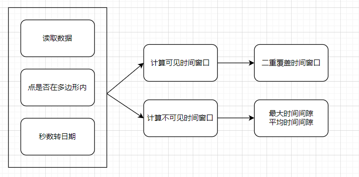
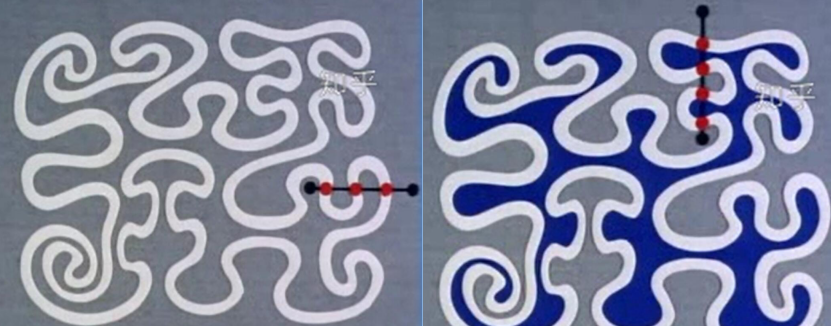
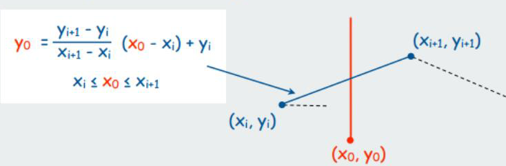
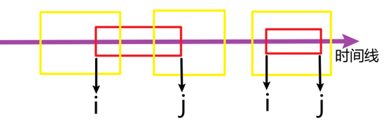
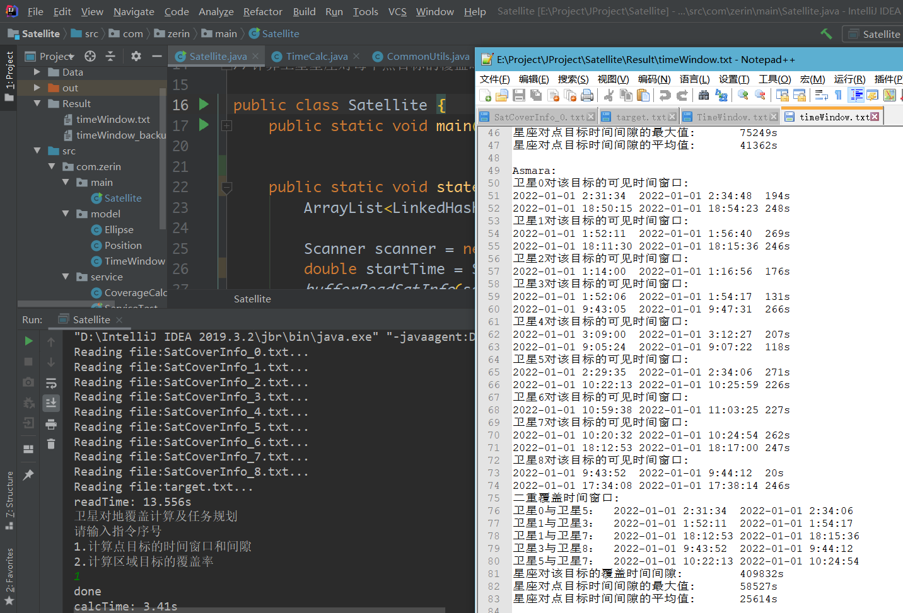
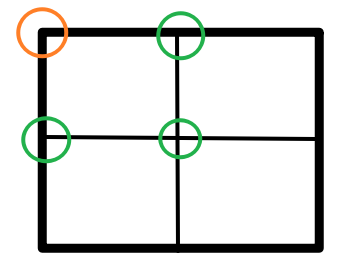

# **Satellite Ground Coverage Calculation and Task Planning**

## Environment Setup

- **OS**: Windows 10  
- **IDE**: IntelliJ IDEA  
- **Language**: Java  
- **Dependencies**: lombok-1.18.16.jar, JUnit4  

## Task 1

### Requirements

1. Calculate the visibility time window for each target point by a satellite constellation, and determine the double coverage time window for each point target.
2. Calculate the coverage time gaps for each target point and compute the maximum and average time gaps for each point.

### High-Level Design

### Detailed Design

#### 1. Data Reading

- **Methods**: `readSatInfo` and `bufferReadSatInfo`
- **Location**: `CommonUtils.java`
- **Optimization**: Initially, we used `Scanner` to read data, which was slow (approximately 115 seconds for complete data). We then implemented buffered reading, which improved performance by 9 times (reducing reading time to approximately 15 seconds).

#### 2. Determining if a Point is Inside a Polygon

- **Method**: `pointInPolygon`
- **Algorithm**: Ray casting method
  - Draw a ray from the point to be tested in the negative x-direction.
  - Determine the intersection points between this ray and each edge of the polygon.
  - Use the Jordan curve theorem: an odd number of intersections indicates the point is inside the polygon; an even number indicates it is outside.

Alternatively, the approach from Task 2 (converting polygons to circles) can be used.

#### 3. Converting Seconds to Date

- **Method**: `toDate`
- **Implementation**: Uses division and modulo operations.

#### 4. Calculating Double Coverage Time Window

- **Method**: `doubleTimeWindow`
- **Algorithm**: Iterate through all time windows and categorize into three cases (as shown in the diagram below). The red box represents the previous time window (first loop), the yellow box represents the next time window (second loop), and ij represents the start and end times of the time window. Time complexity: O(n²).

#### 5. Calculating Coverage Time Gaps

- **Method**: `gapTimeWindow`
- **Parameters**:
  - Maximum time gap for a single satellite covering a single target point.
  - Set of all time gaps.
  - Set of time gaps for all satellites covering a single target point.

#### 6. Overall Calculation for Task 1

- **Method**: `timeWindowCalculate`
- **Algorithm**: Uses four nested loops to iterate over each target point and satellite, calling the above methods to compute the results for Task 1.

### Execution Results

## Task 2

### Requirements

1. Calculate the instantaneous coverage rate for each time point and plot the results as a curve.
2. For a specific moment within the simulation period, visually represent covered, uncovered, and uncertain grids in different colors.
3. Dynamically display coverage rate results at different times (with a time control slider). The ground target area is a rectangular region defined by longitude 75°E–135°E and latitude 0°N–55°N.
4. For uncertain grids, divide each grid into four smaller grids and determine coverage until the total area of uncertain grids is less than 0.1% of the total area.

### High-Level Design

1. Initialize block information for each second in `allBlocks`.
2. For each satellite's second, evaluate grids in `allBlocks`:
   - Confirmed grids are added to the coverage area.
   - Uncertain grids are recorded in a table and placed in an array.
   - Uncertain tables are divided into four new grids.
3. Once the evaluation for a second is complete (and the total area of uncertain grids is less than 0.1% of the total area), update `allBlocks`:
   - Modify the side length of grids in the array.
   - Add newly divided grids.

### Detailed Design

#### 1. Polygon to Circle Conversion

- **Method**: `toEllipse`
- **Purpose**: Convert satellite data from 21 lines per second to one circle per second to reduce computation.
- **Process**: Use the first and 11th data points, with the line segment between them as the diameter. The radius is a constant (7.0068). Directly assigning this constant to the radius variable saves a few milliseconds but reduces universality.

#### 2. Determining if a Point is Inside a Circle

- **Method**: `pointInCircle`
- **Algorithm**: Compare the distance between the point and the circle center with the radius.

#### 3. Further Division of Uncertain Blocks

- **Method**: `reDivision`
- **Process**: From a known point (upper left corner, orange) and a side length, calculate three new points (green) to complete the division.

#### 4. Calculation of Spherical Area

- **Formula**:  
  $$ S = R^2 (lat_2 - lat_1) (\sin lat_2 - \sin lat_1) $$
  - **R**: Earth's radius
  - **lat_1, lat_2**: Latitude values
  - **S**: Spherical area

## To-Do List

1. Separate the calculation process from the output process for Task 1; avoid combining them in a single function.
2. After buffering optimization, file reading with C++ became significantly faster, but assigning cached data remained slow.
3. Include the for-loop logic for the main functions of 12 problems in the readme.

## References

- [Determining if a point is inside a polygon](https://www.cnblogs.com/luxiaoxun/p/3722358.html)
- [Calculation formula for spherical area](https://wenku.baidu.com/view/a9def74633687e21af45a997.html)
- [How to get the value of a custom type key in a HashMap](https://blog.csdn.net/sun_wangdong/article/details/51315106)
- [Writing `equals` and `hashCode`](https://www.liaoxuefeng.com/wiki/1252599548343744/1265117217944672)
- [Why multiply by 31 in `hashCode`? Understanding `hashCode` and hash algorithms in depth](https://www.cnblogs.com/taotaobaibai/articles/13726618.html)
